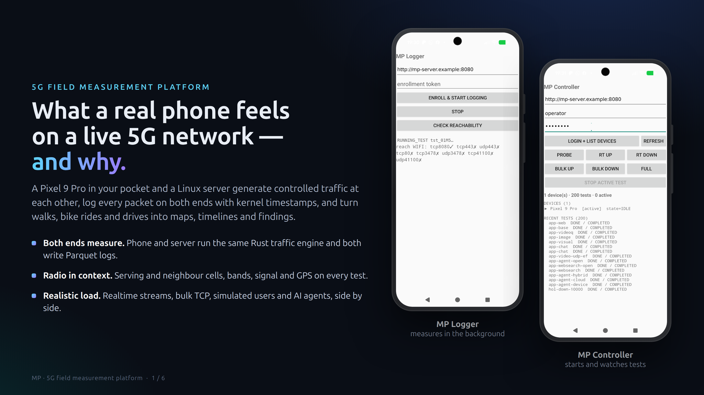
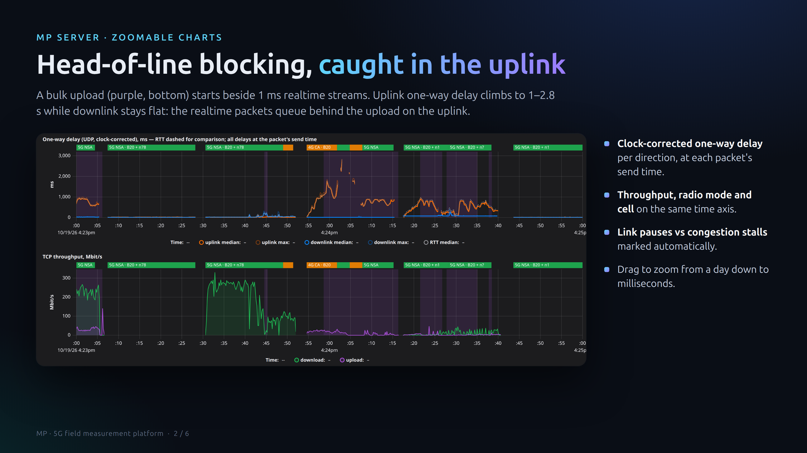
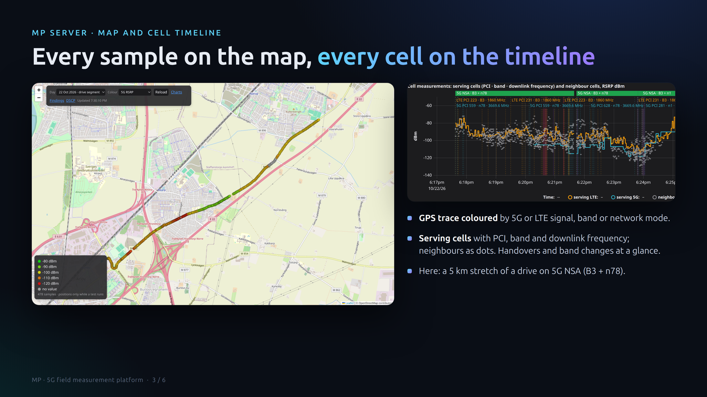
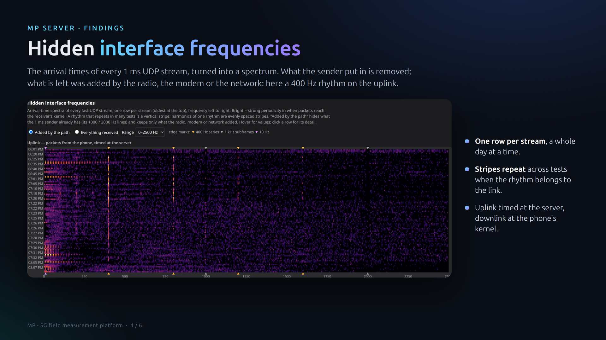
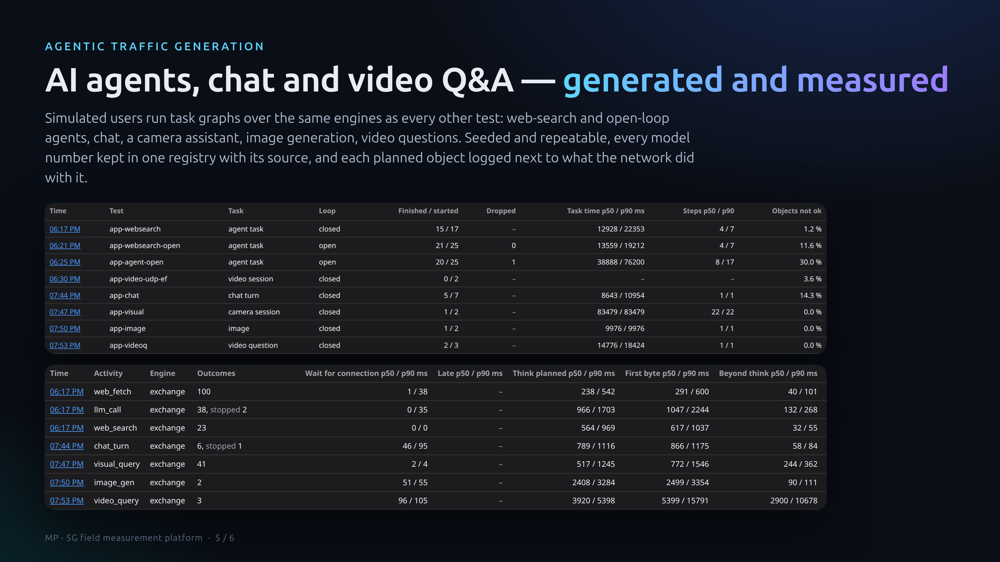
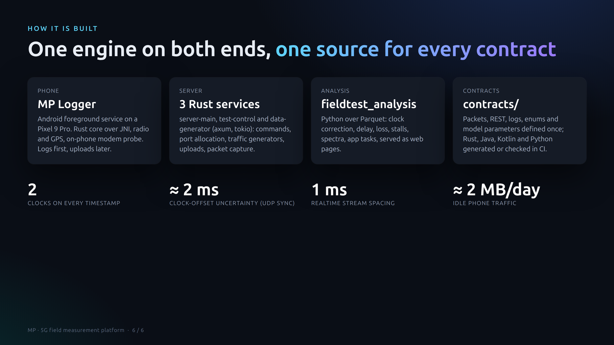

# Measurement Platform

A distributed measurement platform for real-world mobile-network (4G/5G)
experiments.













<sub>Screenshots from the live system (a Pixel 9 Pro and a home server, October 2026). The
phone screens are shown in a drawn Pixel-style frame; server addresses, IDs and the map
location are masked or trimmed.</sub>

## Purpose

Characterise how a live mobile network actually behaves *in the field*. An
Android device moves through coverage while a Linux server generates and
receives controlled traffic on the other end; both sides record dual-clock
per-packet logs and the resulting Parquet is analysed offline.

The platform answers: **what RTT, one-way delay, jitter, loss, throughput,
DSCP transparency, and handover behaviour does this network deliver, at this
place, at this time — and how does that correlate with GPS and radio
metrics?**

> Status: running live — a home server and a Pixel 9 Pro measuring on walks,
> bike rides, drives and commutes (automatic commute trigger). See [`ROADMAP.md`](ROADMAP.md) for the phase
> plan and [`STATUS.md`](STATUS.md) for point-in-time progress.

## Architecture

```
Controller (Android, Kotlin)  ──▶  server-main  ──▶  test-control  ──▶  data-generator(s)
   operator UI                       (Rust)            (Rust)             (Rust, shared core)
                                        ▲
                                        │ REST: enroll / challenge / poll / status / upload
                                        │
                                 Logger (Android, Java shell + shared Rust core via JNI)
```

- **Linux server** (Rust): `server-main` (REST, registry, command queue,
  SQLite, uploads), `test-control` (scheduler, port allocation, generator
  coordination, per-test packet capture), `data-generator(s)` (the server
  side of every flow: probe and DSCP-probe echo, realtime UDP, bulk TCP,
  and the app-traffic server for request/response objects and paced UDP
  bursts).
- **Android Logger** — autonomous measurement client; foreground service
  drives the shared Rust core via JNI, samples GPS/radio, uploads sealed
  logs. Talks only to `server-main`.
- **Android Controller** — operator console (Kotlin): fleet view,
  start/stop tests, watch live state. Performs no measurement.
- **Python analysis** (`analysis/`) — tolerant Parquet loaders, metrics,
  derived radio events, plots.

## What you can measure

### Traffic flows (mixed freely in one test)

| Flow            | Direction(s)              | Measures                                                         |
|-----------------|---------------------------|------------------------------------------------------------------|
| `probe`         | bidirectional echo        | RTT, jitter, packet loss; cheap heartbeat                        |
| `realtime_udp`  | `FromServer` / `ToServer` | one-way delay, inter-arrival jitter, loss at fixed PPS (1 ms streams; socket buffer settable) |
| `bulk_tcp`      | `FromServer` / `ToServer` | sustained throughput (UL or DL) with per-chunk arrival logging; optional rate cap and byte target (head-of-line tests) |
| `app_traffic`   | both                      | simulated users and AI agents: per-task and per-object timing, completion, and their impact on the realtime streams |
| `gateway_ping`  | local (UE → first hop)    | first-hop latency to the auto-discovered gateway (rmnet / wlan)  |
| `dscp_probe`    | bidirectional, marked     | DSCP transparency UL and DL independently (which bits survive)   |

Both endpoints log every flow into per-packet Parquet with embedded sender
timestamps, so OWD and jitter can be reconstructed offline.

### Application traffic (`app_traffic`)

Simulated users built in layers: a **workload model** decides what to move
and when (no sockets), a **scheduler** runs it open- or closed-loop with
dependencies, and shared **traffic engines** move the bytes. Every planned
object is logged (`app_events.parquet`) next to what the network did with it.

| Profile | What a user does |
|---------|------------------|
| `web` | page views: HTML, then 5–120 objects over 6 connections, then reading |
| `mail` | periodic syncs, sometimes an attachment or a sent mail |
| `video` | 4 s segments at 1.5 / 3 / 5 Mbit/s, sessions of 1–5 min |
| `social` | feed images in bursts with short pauses, now and then a photo upload |
| `mixed` | switches between web, social and video every 2–5 min, mail in the background |
| `agent` | an AI agent: LLM calls with streamed replies, tool and MCP calls, web fetches, a growing context |
| `websearch` | an agent answering by web search: a task graph of searches, fetches and LLM calls |
| `chat` | LLM conversations: prompts up, token streams down |
| `visual` | a camera assistant: a frame up every 3.9 s, short streamed answers down |
| `image_gen` | a prompt up, previews and a 0.5–3 MB image streamed down over 5–30 s |
| `video_understanding` | a 5–50 MB clip up with a question, a streamed answer down |
| `script` | a scripted timeline (e.g. written by an AI playing a user) |

Options per flow: `workers` (concurrent users), `seed` (repeatable runs),
`scale` (shrink object sizes to save data, timing unchanged), `placement` for
agents (tools on the `device`, in the `cloud`, or `hybrid`), `loop` (`closed`,
or `open` with tasks arriving every `task_interval_s`), `engines` per activity
(`exchange` on pooled connections, `bulk` on a connection of its own, or
`udp_burst` paced datagrams) and `dscp` marking per activity. Every number
the models draw from lives in one registry
([`contracts/app_traffic/parameters.yaml`](contracts/app_traffic/parameters.yaml))
with its source and status; its version is written into each test's header.

### Derived metrics (`analysis/`)

- **RTT** + inter-arrival jitter (`probe`)
- **One-way delay** with explicit clock-uncertainty bounds (`realtime_udp`)
- **Packet loss** and sequence-gap analysis (any UDP flow)
- **Throughput** p50/p95 (`bulk_tcp`)
- **App tasks** — finished/started, task time, per-object wait, think time vs
  first byte, open-loop drops, and the extra delay apps cause on realtime
  streams (`app_traffic`)
- **Delivery timing** — kernel receive times, stalls (link pauses vs
  congestion), arrival-time spectra ("hidden interface frequencies"),
  uplink saturation and modem back pressure
- **DSCP transparency matrix** (preserved / remarked / stripped, UL and DL)
- **Handover / coverage-gap / band-change events** — derived post-hoc from
  `radio.parquet` (PCI/NCI/band transitions), not logged live

### Contextual signals (mobile, once per test)

- **GPS** position track (`gps.parquet`)
- **Radio**: serving cell (PCI, NCI, TAC, NRARFCN, RSRP, RSRQ, SINR),
  neighbor cells, LTE fallback (`radio.parquet`)
- **Clock-sync samples** — mono ↔ utc ↔ gps offsets, the OWD uncertainty
  input (`clock.parquet`)
- **Modem view** — `mp-probe`, an adb-started collector on the phone: modem
  queue (qdisc) stats, UDP counters and radio-log events (`probe.jsonl.gz`)
- **Wire view (server)** — headers-only packet capture of each test's bulk
  and app ports (`server/capture.pcap.gz`): segment and ACK sizes,
  retransmissions, server-side RTT, DSCP that arrived

### Modes

- **Logger** — test-driven: polls for `RUN_TEST`, runs flows, seals the log
  dir, uploads when convenient.
- **Monitor** — always-on background probing (server-configured) for
  continuous network-quality coverage.

### Platform features

- Hardware-backed device identity (P-256 enroll + challenge/response)
- Server-configured logging — effective config =
  *plan profile ∩ device capability ∩ overrides*, versioned, pushed via
  `SET_LOGGING_CONFIG`
- Resumable upload with per-file SHA-256 manifests
- Forward-compatible logs — additive-only, unknown fields tolerated
- Operator REST client generated from the OpenAPI contract
- Low idle cost — command long poll and status on change: ~2 MB/day per
  idle phone
- Calibration tooling — `fieldtest_analysis.tls_trace` turns a headers-only
  capture of a real app's TLS traffic into request/reply evidence for the
  model parameters

## Design philosophy: one source

Two architectural decisions sit under nearly every line of code. They both
say the same thing — *don't allow two versions of the same fact to exist* —
applied to two different surfaces.

### 1. `contracts/` is the only source of truth for every cross-component shape

REST DTOs, command payloads, wire packet layouts, Parquet column schemas,
enums, SQL schema, framing constants — all live in one directory:

```
contracts/
  versions/   enums/   schemas/   packets/   parquet/   testvectors/
  db/schema.sql        openapi/openapi.yaml        internal/
```

Every implementation either **generates from** the contract or
**parity-tests against** it; CI fails any PR where they drift:

- **Codegen** for REST (`openapi.yaml` is generated from the Rust server via
  `utoipa` and drift-gated).
- **Parity tests** for enums, JSON examples, and DB schema (`parity.rs`,
  `migration_matches_contract_schema`).
- **Golden vectors** for binary packets — committed `{hex, decoded}` rows
  that every codec round-trips. Bit-compatible by construction, in any
  language.

Adding a wire field touches the contract first; the parity gates then refuse
to merge until the implementations catch up. The seam is patrolled by the
compiler, not by reviewers.

### 2. `core/` is one shared Rust engine, used by both server and Android

Anything that **processes a measurement** — packet codecs, dual-clock
timestamps, Parquet writer with wait-free SPSC handoff, auth crypto, the
traffic-engine flow threads — lives in `core/` (`fieldtest-core`). It has
no `axum`, no `tokio` runtime, no Android, no JNI in its public API. It
just runs.

- The **server** uses it via a regular path dependency.
- The **Android Logger** cross-compiles it (`cargo-ndk`) into a `.so`
  loaded via a thin JNI shell; the Java side only owns Android-specific
  glue (foreground service, permissions, Telephony, GPS).

The same `core::ue::UeEngine` that runs on the Pixel runs in the server's
host-mode integration test driving the real `data-generator` over
localhost. If a flow works in `ue_interop`, it works on the phone.

> **Why this matters.** Contracts pin *shapes*; the shared core pins
> *behaviour*. Either alone leaks bugs — bytes that match but mean
> different things on each side, or shapes that drift between consumers.
> Together they collapse the cross-language seam to one small JSON-shaped
> JNI handoff, itself governed by a contract.

The longer-form rationale is in
[`planning/symmetry_and_shared_core.md`](planning/symmetry_and_shared_core.md);
the implementation discipline (codegen, golden vectors, CI gates) is in
[`planning/development_guide.md`](planning/development_guide.md).

## Cross-cutting invariants

These are honoured by every component:

1. **Logging-first** — local writes never block on the network; uploads are
   strictly deferred.
2. **Dual-clock timestamps** — `mono_ns` (ordering, jitter) and `utc_ns`
   (cross-node, OWD). Never collapsed into one clock.
3. **Server-configured logging** — the UE logs only what the server enables.
4. **Forward-compatible logs** — every field optional, additive-only,
   unknown fields tolerated.
5. **UE always initiates** — the mobile opens every connection
   (NAT/firewall punch-through).
6. **Symmetric peers** — both nodes generate, receive, and log; *direction*
   only picks which side sends payload.

## Quickstart

```bash
# Rust workspace — server, core, contract gates
cargo build
cargo test --workspace

# Full local CI gate (fmt, clippy, tests, contracts, analysis, client drift)
ci/check.sh

# Python analysis toolchain
cd analysis && python3 -m venv .venv && .venv/bin/pip install -e ".[dev,plots]"
.venv/bin/python -m fieldtest_analysis <test_dir> --plots out/

# Android (needs SDK + NDK + Gradle 8.13; no wrapper committed)
android/build_apk.sh                              # Logger: cargo-ndk core → APK
(cd android && gradle :controller:assembleDebug)  # Controller
android/controller/generate_client.sh             # regen REST client from OpenAPI
```

Full end-to-end on-device bring-up (servers, operator + enrollment token,
device enroll/auth, posting a test plan, collecting Parquet) is in
[`planning/device_bringup.md`](planning/device_bringup.md).

## Repository layout

```
core/         shared Rust engine + Parquet logger (native + Android .so via JNI)
server/
  contracts-rs/   DTOs + enums (utoipa ToSchema) — Rust face of contracts/
  server-main/    REST API, registry, uploads, SQLite
  test-control/   scheduler, port allocation, generator coordination
  data-generator/ UDP probe / realtime UDP / bulk TCP / DSCP probe echo
android/
  logger/         Java shell + core via JNI
  controller/     operator console (Kotlin)
analysis/     Python package (fieldtest_analysis): loaders, metrics, plots
contracts/    single source of truth (OpenAPI, JSON Schema, Parquet, enums,
              packets, DB schema, golden vectors)
ci/           local gate (check.sh) + contract & client-drift validators
planning/     architecture spec + per-phase design + runbook
```

## More documentation

- [`docs/OPERATORS_GUIDE.md`](docs/OPERATORS_GUIDE.md) — operate every part of the system.
- [`planning/5_g_field_test_platform_architecture_spec.md`](planning/5_g_field_test_platform_architecture_spec.md) — authoritative architecture & functional spec.
- [`planning/symmetry_and_shared_core.md`](planning/symmetry_and_shared_core.md) — the *why* of contracts + shared core.
- [`planning/development_guide.md`](planning/development_guide.md) — the *how* (codegen, golden vectors, CI).
- [`planning/development_plan.md`](planning/development_plan.md) — build sequencing.
- [`planning/peer_topology_extension.md`](planning/peer_topology_extension.md) — proposed peer-topology extension.
- [`AGENTS.md`](AGENTS.md) / [`CLAUDE.md`](CLAUDE.md) — agent-oriented guides.
- [`ROADMAP.md`](ROADMAP.md) · [`STATUS.md`](STATUS.md) — phase plan & progress.

## Reference device & scope

Reference device is the **Pixel 9 Pro**. DRX, 5QI/QFI, MCS/CQI/BLER/HARQ,
and RRC-state are not exposed without root and are out of MVP scope;
handovers are derived retrospectively from PCI/NCI changes. The
architecture is intentionally built to grow from a "test instrument" into a
continuous network-quality probe without a rewrite — see
[`planning/long_term_traffic_monitoring.md`](planning/long_term_traffic_monitoring.md).
